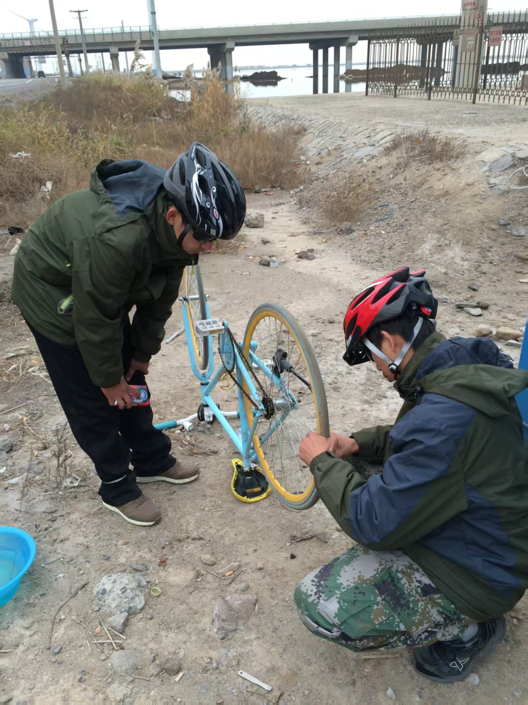
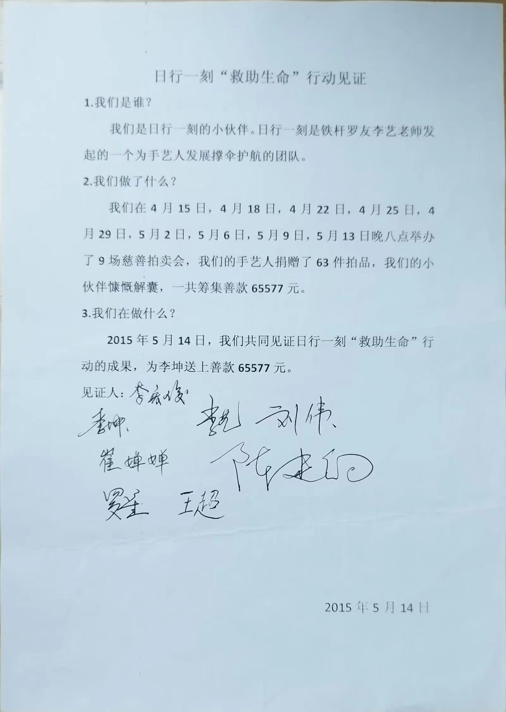

# 个人简介

我是一个靠自学学会编程的文艺爱好者。我做过许多项目，用过包括 Rust、Go、Python、AS/JS、Node.js、C/C++、C# 在内的许多语言。我从不忌惮学习任何语言，语言就像机械师手中的工具，需要用哪个拿哪个便是。我坚信任何人都可以轻松学会编程，也应该学会编程，尤其在今天这个有 AI 辅助的时代。

早年我是 Adobe 中国最佳贡献社区管理员之一，后来获得腾讯云最具价值专家（TVP）、极客时间荣誉讲师、中移联合智库 ICT 专家级讲师等荣誉奖项。我曾担任大学计算机讲师与国内大型企业内训讲师，出版过《微信小游戏开发》《小程序从0到1》等计算机图书，并在极客时间与微信学堂上线过多门系统级结构化课程。

代码之外，我沉迷于金石篆刻与书法，喜欢烹饪与骑行，富有一定的社会洞察力与社会责任感，曾于 2015 年以个人身份自发为北医三院白血病患者筹集并捐助 65,577 元善款。我是一个内向寡言的人，但也喜欢结交慎思笃行、真诚纯粹的朋友。欢迎与我连接。

## 出版著作 & 在线课程

* 2023年02月，在机械工业出版社出版[《微信小游戏开发》](https://item.jd.com/13630053.html)上下两册
* 2017年12月，在机工出版[《小程序从0到1》](https://e.jd.com/30401467.html)

- 2022年04月，在微信学堂上架[《小程序性能优化实践》](https://developers.weixin.qq.com/community/business/course/000606628dc2e86dc0ddcbb115940d)视频课程
- 2020年05月，在极客时间上架[《微信小程序全栈开发实战》](http://gk.link/a/10AdC)视频课程

## 荣誉奖项

* 2024年04月，被授予「极客时间荣誉讲师」称号
* 2023年01月，被授予「中移联合智库 ICT 专家级讲师」称号
* 2021年07月，获腾讯课堂「2021年度最具影响力专家」荣誉奖项
* 2019年10月，获得「VIPKID 黑马大赛好技术金点子」一等奖
* 2019年08月，获腾讯云「[腾讯云最具价值专家（TVP）](https://cloud.tencent.com/tvp/member/124)」荣誉奖项
* 2011年10月，被评为「Adobe 中国最佳贡献社区管理员」15位之一

## 社会公益

2015年05月为北医三院白血病人捐款 65577 元。

## 联系方式

* 邮箱：<9830131@qq.com>
* 微信：[9830131](https://x.com/jinshimanong)

欢迎连接。
