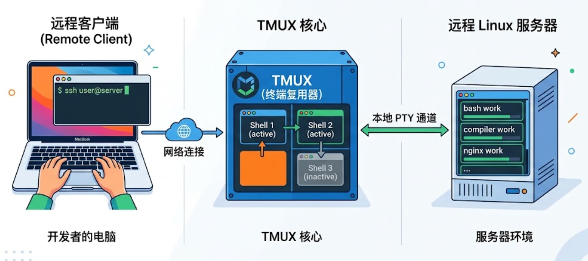

# 使用 kitty+tmux 实现本地远程多端复用

在使用远程服务器作为工作电脑时，我们常遇到这样一个痛点：服务器本地运行着一个 Kitty 终端，换台电脑通过 SSH 连入时，却进入了全新的环境，无法查看和继续原先的终端。

要解决这个本地、远程跨设备无缝衔接的问题，我们需要先厘清现代 Linux 终端的底层架构。

## 一、 终端模拟器 vs 终端复用器

在现代 Linux 架构中，“终端”并非单一程序，而是前端与后端的组合：

- Kitty（终端模拟器 / 前端）： 如 Kitty、Terminal 等，属于纯 GUI 程序，它只负责渲染画面和捕获指令输入，不负责执行系统命令。
- Shell（命令解释器 / 后端）： 如 Bash / Zsh，是负责真正执行指令逻辑的环境，各自都有一个配置文件，例如.zshrc、.bashrc等。

为什么 SSH 无法直接连接 Kitty？

当使用 SSH 登录时，系统会分配一个全新的伪终端（PTY）和 Shell 环境，与服务器本地已经运行的 Kitty 通道是隔离的。

引入 Tmux 的理由：

让 Tmux 作为后台守护进程接管真正的 Shell（后端）。此时，服务器上的 Kitty 和远端连入的 SSH 客户端统统降级为“前端”。Tmux 里的任务永不断线，且不同客户端接入同一个 Tmux 会话，即可实现画面同步与命令接管。



## 二、 实战代码

基于上述方案，我们有三个代码需要实现：服务器上启动终端环境、服务器上执行终端指令、本地通过 ssh 连接服务器上的终端环境。

1. 服务器如何启动？（启动脚本核心）

脚本的核心在于：处理无头（Headless）环境的虚拟渲染，并让 Kitty 启动时直接挂载 Tmux 会话。

核心 Bash 脚本：

```bash
#!/bin/bash
SOCK_PATH="${HOME}/.kitty.sock"
SESSION_NAME="workspace"
exec kitty \
  -o allow_remote_control=yes \
  --listen-on="unix:${SOCK_PATH}" \
  tmux new-session -A -s "$SESSION_NAME"
```

精髓： tmux new-session -A -s workspace。这句命令实现了“如果有 workspace 会话就接入，没有就新建”，防止重复创建。workspace 可以自定义，叫别的也可以。

2. 服务器 Rust 程序如何向终端注入并执行指令？

就是执行一句话：

```bash
tmux send-keys -t workspace "your_command" C-m
```

与一般执行指令有差别的地方，就是将指令发给 tmux：

```bash
let output = Command::new("tmux")
  .arg("send-keys")
  .arg("-t")
  .arg("workspace") // 目标会话名称
  .arg(cmd)         // 要执行的命令
  .arg("C-m")       // 模拟按下回车键
  .output()
```

由于 Tmux 守护进程掌握着真正的 PTY，我们通过 tmux send-keys 将字符串和回车符（C-m）直接写入 PTY 输入缓冲区。此时，无论终端界面是显示在服务器屏幕上，还是远端 SSH 屏幕上，都会同步看到这段命令被键入并执行。

3. 远程连接：本地 Mac 如何通过指令一键直连

当你在本地 Mac 上，想要立刻连入服务器上那个名为 workspace 的工作环境，只需要一条携带特定参数的 SSH 命令。

```bash
ssh -t user@your_server_ip "tmux attach -t workspace"
```

"tmux attach -t workspace"： 登录成功后，不进入默认的 Bash 提示符，而是直接将当前 SSH 的 PTY 桥接到后端的 tmux 会话中。

为了日常使用更加便捷，可以在 Mac 本地的 ~/.bashrc 或 ~/.zshrc 中配置一个 Alias（别名）：

```bash
alias tmux-ssh='ssh -t user@your_server_ip "tmux attach -t workspace"'
```

## 小结

本质上，Tmux 是在“终端模拟器（Terminal Emulator）”与“命令解释器（Shell）”之间建立了一座关键桥梁。它接管了底层的伪终端（PTY），让我们可以在本地 Mac 上通过 SSH 跨越网络，无缝接入并复用远程服务器上早已存在的运行现场。

“终端（Terminal）”其实是一个极具历史感的词汇。在没有 GUI（图形用户界面）的早期时代，操作员只能对着纯文本的物理机器敲击命令来控制计算机。随着操作系统的演进，图形界面成为了主流，但“终端”并没有消失，而是以软件的形式（终端模拟器）藏在了桌面系统里。

在默认情况下，无论是打开一个 Kitty 窗口，还是发起一次 SSH 连接，系统都会分配一个全新的、相互隔离的伪终端通道。一旦窗口关闭，通道与任务便随之销毁。而 Tmux 的成功之处，就在于它像一个坚固的“集线器”，将这些原本平行的、阅后即焚的通道强行“束”在了一起。
